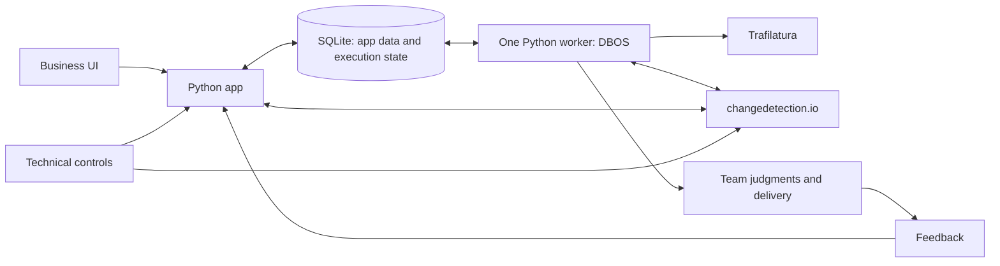

# SignalWatch: competitor content monitoring

Status: **DRAFT FOR DISCUSSION** — a proposed design, not approval to build it.

## TL;DR

Build a Python app with a simple business UI. Propose Trafilatura to find publications and changedetection.io to track page edits. The app decides what matters to each team, sends it through one channel, and collects feedback. Use SQLite and DBOS with one dedicated Python worker for durable background work.

## Goal and scope

Manual checks miss publications and quiet page edits. Sending everything creates noise. Marketing, Product, and R&D need separate judgments about what matters.

Business users must add competitors, topics, and interests without technical setup. The system must run unattended and support handover. The deadline is seven days; the design must address two years of operation.

Start with supported sources and one delivery channel. Universal website support, extra channels, and automatic model training are outside the first version.

## Proposed parts and ownership

Only the server and greeting page exist; full discovery-to-delivery integration is untested. Python is fixed. [Local engine/browser checks](../qa/runs/2026-11-16-changedetection.md) passed. Proposed parts:

- **Python app:** owns business settings, source/watch links, content versions, team decisions, delivery status, and feedback. Its UI shows coverage, results, and held items with reasons and "should have been sent" feedback.
- **Trafilatura 2.3.1:** [finds page URLs](https://trafilatura.readthedocs.io/en/latest/crawls.html) and [extracts article text](https://trafilatura.readthedocs.io/en/latest/). Its [feed helper returns article URLs](https://github.com/adbar/trafilatura/blob/v2.3.1/trafilatura/feeds.py), not feed addresses. It does not run JavaScript. The app must schedule discovery and remember seen items.
- **changedetection.io:** runs separately in Docker. The app uses its [REST API](https://changedetection.io/docs/api_v1/index.html) for page history and stored copies. Its [optional browser](https://github.com/dgtlmoon/changedetection.io/blob/master/docker-compose.yml) handles rendered pages when needed.
- **SQLite and DBOS:** SQLite holds app data and DBOS execution state on persistent local storage shared by the app and worker on one host. The web app enqueues through [DBOSClient](https://docs.dbos.dev/python/reference/client), without executing jobs. One dedicated Python worker runs the [DBOS runtime](https://docs.dbos.dev/python/programming-guide). Configure retries for network, model, and delivery steps, and show exhausted failures. After a supervised restart, DBOS recovers persisted unfinished work.

The app creates and retires watch targets. Its separate maintainer area covers discovery rules, prompts, delivery settings, and failed work. The engine dashboard handles per-page fetch/browser settings, selectors, and detection rules. App updates preserve those fields. Use separate business/maintainer roles. Keep credentials server-side. Treat page text as evidence, never instructions.

## Flow

1. **Configure monitoring.** Business users add competitors and edit each team's topics and short "what matters" note. These apply to all followed competitors. Default edit watches cover the homepage and main product/pricing pages when available; users can add/remove page URLs. Maintainer policy handles supported source discovery/extraction. Show coverage gaps. JavaScript-only discovery needs a supported fallback.
2. **Save the starting point.** Remember existing publication IDs and each watched page's first stored copy. Do not announce old material as new. Later unseen articles are candidates; use publication dates to distinguish new posts from older finds and label uncertainty. Page edits carry before/after evidence.
3. **Collect changes.** A webhook is a wake-up hint. Persist a processing job through DBOS before acknowledging it. The worker reads page history; regular API history jobs catch missed signals. Both use saved watch/version IDs to avoid repeat processing. Read first copies explicitly. An edit that only adds an article link becomes discovery of that article, keyed by its URL, not a separate alert. Other page edits get independent team judgments.
4. **Judge each team separately.** Use each team's topics and "what matters" note. Ground explanations in the observed content. Compare a competitor with Noma only when the business-provided note supplies the relevant context; otherwise, describe the competitor's change without assuming what Noma lacks. An item can matter to none, one, or several teams. Keep evidence, reasons, and model/prompt/settings versions. Layout noise can be removed; judge relevance separately for each team.
5. **Send useful results.** Save pending delivery, then send through an existing transport library. Choose Slack or email. Include what changed, why it matters, and source links. Track item version, team, and destination to avoid known repeats. If a send succeeds but its reply is lost, retrying can still duplicate it.

Save processing/delivery state in SQLite so work can resume. Skip disabled sources in app collection jobs and delivery; engine pause stops only scheduling. Before watch deletion, save evidence required by retention policy because engine history becomes inaccessible. Topic edits apply to later discoveries; never automatically recheck or resend past items.

## Operation and quality

Show collection, model, and delivery failures. Configure DBOS step retries and notify operators when help is needed. Derive last success from completed outcomes, never `last_checked` alone; show it separately from last publication. Track source checks separately from item counts; empty or fallback results do not prove source health. Show uncertain coverage when success is unknown. Missing completion heartbeats from scheduled checks must alert maintainers through an outside path independent of team delivery. Handover needs saved state, supervised restarts, backups, protected secrets, and tested pinned releases.

Keep a stable worker identity. Before workflow or DBOS SDK upgrades, finish or recover pending work with matching code and application version; startup recovery does not resume arbitrary changed workflow code.

Each team's business owner supplies expected judgments and reviews samples. The maintainer compares results against saved examples. Sample source material and held items to find misses; add confirmed cases to the examples. Track useful/irrelevant/wrong-team feedback, misses, and false alarms. Show trends. Revise topics, extraction, or prompts deliberately, then compare again. Feedback does not train the model. Numerical quality targets need agreement.

As volume grows, limit concurrent fetches/model calls, respect provider limits, and reuse content across teams. Size concurrency and storage from measured load and cost.

## Tradeoffs and open decisions

Reusing discovery and monitoring avoids building a crawler and page-history engine. It adds a service and history catch-up work.

SQLite fits the expected modest writes on one host; keep writes short. DBOS provides durable jobs, retries, and restart recovery without a queue we must write or a database server to operate. One worker keeps setup small; capacity remains unmeasured. We accept DBOS's workflow/versioning dependency. Its docs recommend PostgreSQL for production; this choice is scoped to the single-host assignment.

PostgreSQL + PgQueuer is a viable durable queue, but adds a database service/container the expected workload does not need. Reconsider PostgreSQL for multiple hosts, high write concurrency, or a broader production deployment.

Temporal adds durable orchestration and operational tools, but requires a separate service or Temporal Cloud setup and cost. The current workflow does not justify that operational burden.

Before building, settle supported sources/fallbacks, numerical quality targets, delivery channel, model/evidence limits, hosting, retention/deletion, and acceptable delay/volume/cost. Define which network addresses user-entered URLs may reach. No scale targets or application behavior are claimed.
